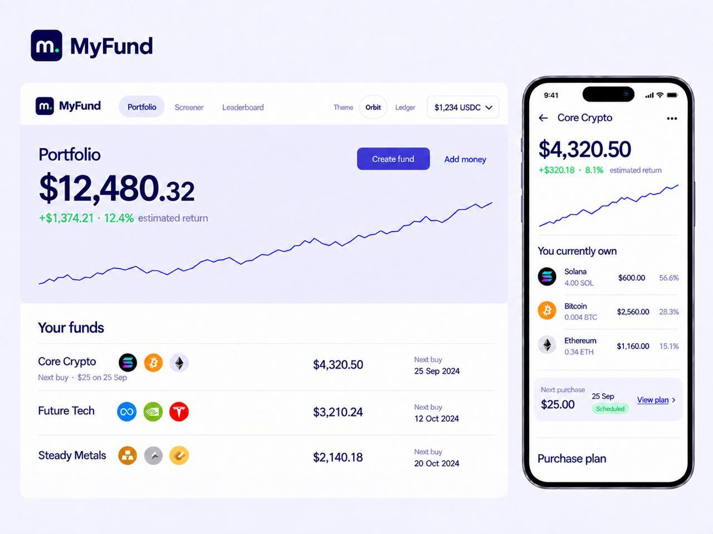

# OhMyFund design

## Product feeling

OhMyFund should feel safe, quiet, and precise. It is a savings product, not a trading terminal. Pages should make the user's value, basket, next intended action, and any missing data easy to understand.

## Active themes

The app defines two visual themes. Orbit is the one users see. Ledger is kept for design comparison only and is not reachable from the interface — compare the two by changing `data-theme` on the `<html>` element in `apps/web/app/layout.tsx`. Neither theme changes account data.

The theme selector is deliberately not mounted in the navigation. It occupied a full row of the mobile header, which pushed the page content below the fold, and a control for comparing designs is not something a person depositing money needs to see. `apps/web/app/theme-switcher.tsx` still exists so the selector can be restored in one line if that decision is revisited.

- **Orbit:** the preferred identity direction. Pale lavender surfaces, deep indigo text, a mint logo signal, generous spacing, and rounded sections.
- **Ledger:** a more restrained alternative. Cool off-white surfaces, blue-black text, slate accents, tighter rules, and tabular financial values.

Both themes use the butterfly-and-wordmark OhMyFund lockup. Preserve its deep indigo butterfly and lettering, mint wing insets, mint antenna dot, proportions, and transparent background. The production navigation asset is `apps/web/public/brand/ohmyfund-orbit.png`.

## Orbit interface system

The app-wide visual layer lives in `apps/web/app/ui-rebuild.css` and follows the semantic roles in `tokens.css`. It keeps the existing Bricolage, Reddit Sans, and Reddit Mono font roles and the indigo, lavender, and mint Orbit palette. English is the current interface language.

- **Portfolio:** lead with the real value state and wallet cash, then the user's fund list. Create fund and Copy a public fund sit in the list toolbar beside the fund search, with the funds they act on. Signed-out Portfolio uses a split introduction and a structured market index.
- **Fund detail and editor:** lead with the saved target basket and truthful draft state. Create a fund in a single dialog together with its recurring plan; keep existing-fund edits on a full page.
- **Screener and Leaderboard:** keep comparison rows, visible sorting and copy/add actions. On narrow screens, the Screener add action remains directly reachable.
- **Chrome and controls:** three existing destinations, compact account control, one indigo action accent, visible rules before shadows, 8px controls and 14px main panels. Existing decorative round assets can remain round.
- **Motion:** restrained CSS feedback for controls and state changes. Financial figures stay still. Reduced-motion users receive immediate state changes.

This visual system preserves routes, basket validation, data ownership, and transaction capability. The asset-add and fund-creation journeys now make authentication and draft status explicit.

## Visual references

The Orbit composition below is the primary visual reference for hierarchy, spacing, portfolio emphasis, fund rows, and the desktop-to-mobile relationship. The image predates the OhMyFund rename, so its former wordmark is not current brand copy.

The [Orbit pitch deck](https://myfund-slides.vercel.app/?theme=orbit#1) is the presentation reference for color, typography, and product storytelling. Its current URL and rendered wordmark are legacy external identifiers until that separate deployment is renamed.

## Navigation

The global navigation contains:

- **Portfolio:** aggregate app-attributed value, performance state, and the user's funds.
- **Leaderboard:** public funds ordered by the current leaderboard rules.
- **Screener:** approved assets from the saved Tokens.xyz catalog.

On phones the bottom bar holds Portfolio, Screener, a raised round **+**, Leaderboard and Wallet. Tapping **+** creates a fund (after sign-in when needed); holding it opens a half-ring fan of two wedges, Create fund and Copy a public fund, and the finger can slide onto either and release. The signed-in Portfolio hides its own Create/Copy buttons on phones because **+** covers them. On phones the header keeps only the logo; the last tab reads Sign in when signed out. The signed-out Portfolio fits one phone screen without scrolling, centred between the header and the bottom bar.

There is no global Activity tab. Each fund detail ends with an Activity section containing **Fund edits** and **Recurring payments** tabs.

## Screen hierarchy

### Portfolio

On mobile, lead with the total-value summary and keep the fund list below it. On desktop, the fund list takes the main column with Create fund and Copy a public fund above it, and the summary sits in the right column beside it. Available USDC belongs in the wallet control and is not strategy performance.

### Fund detail

Show the saved target basket first. Only display holdings, returns, or performance when confirmed purchases can be attributed to that fund; otherwise explain that the values are unavailable. On mobile, keep recurring plans and activity below the strategy. On desktop, recurring plans (including cancelled ones) sit in the right column beside the basket, and activity stays in the main column under it. On small screens, avoid putting the full recurring-purchase plan in the first viewport.

Fund creation is one dialog on Portfolio: name, asset search, target weights, and the recurring plan share the same surface. The plan is required when creating a fund and is saved as a draft until the user approves it. Saving returns to the Portfolio fund list without opening a second plan step or an automatic detail page. Editing an existing fund remains a full page with a `← Fund name` back link. Asset allocation must not contain a Payment History button.

Create fund and the standalone draft-plan editor use the same dialog rhythm: compact fixed header, one scrollable content area, stable action footer. Keep target-total feedback beside the Create action, and show schedule fields in a compact grid with a draft preview. Avoid nested scroll areas inside the asset picker.

### Screener

Start with search, category tabs, and the table. Sorting lives in sortable column headers. Do not add a second sort dropdown or direction button. Show a real local logo when available and a quiet initials fallback when it is not.

### Leaderboard

Funds appear as one ruled list: rank, name, publisher and copy count, then the target weights on a single line, with a quiet outline Copy action. On phones the page opens straight on the list.

Browsing and fund detail are public. Copying requires authentication. Public views contain target composition and publisher metadata, never private balances, plans, or activity.

## Interaction rules

- Use clear 44px minimum touch targets and visible keyboard focus.
- Keep money and percentages aligned with tabular numerals.
- Use separators and spacing before adding containers or decoration.
- Do not animate financial numbers from zero.
- Do not use fake performance curves or optimistic transaction success.
- Show missing or stale data as unavailable.
- State that changing weights affects future purchases; existing holdings are not rebalanced.
- Preserve exact asset mint identity when changing issuer variants.

## Responsive rules

### Page layout

Mobile and desktop are separate standards, not one layout scaled. Every screen sits in one container whose left edge is the logo's edge, so content never jumps sideways between tabs. The tokens live at the top of `apps/web/app/ui-rebuild.css`.

| Tier | Width | Gutter each side | Content |
|---|---|---|---|
| Desktop | above 900px | 32px, container capped at 1240px | Screens use the full container, split into a main and a side column where they have supporting content. |
| Tablet | 701–900px | 20px | Full container width. |
| Mobile | 700px and below | 16px, 12px at 380px and below | Full width, one column, bottom navigation. |

A screen must not set its own container width or centre itself. Use `--page-width` for containers and `--content-max` for reading columns; add a token rather than a new pixel value. On desktop, space beside a form or list goes to a side column, not to stretching text or inputs.

Desktop placement lives in one file, `apps/web/app/desktop.css`, entirely behind `min-width: 901px`, so tablet and mobile never see it. Place blocks with grid; never reorder the source, so keyboard order stays top to bottom. Desktop controls are 40px high with 14px text.

- **Portfolio:** the value panel leads across the full width with its metrics on the right, as in the Orbit reference. The Your funds heading carries the toolbar on its right (search, Create fund, Copy a public fund), and the fund list runs full width below.
- **Fund detail, Edit fund and Wallet:** the main task in the wide left column and what supports it in a `--side-width` (340px) right column, `--column-gap` apart: recurring buys beside the basket; the target total and Save beside the form, sticky while the form scrolls; the address and account actions beside the balance.
- **Screener:** search and the snapshot note share the first line, then tabs and the full-width table.
- **Leaderboard:** the heading carries the totals on its right; the list is one full-width ruled table of rank, name and publisher, target weights and Copy.

The tablet header is a single row like desktop, with a narrower logo and tighter nav.

- Desktop uses the wide summary and chart composition.
- Mobile keeps the same information order, stacks sections, and moves detailed plans lower in the scroll.
- Navigation and theme controls must not overflow at 375px.
- Tables may reduce secondary columns, but name, ticker, issuer, price, and change remain understandable.

## Source of truth

The production implementation in `apps/web` is the current UI source of truth. `docs/designs/simple.html` and other files in `docs/designs` are historical prototypes and references. They may contain superseded flows and must not override this document or [PRODUCT.md](PRODUCT.md).
